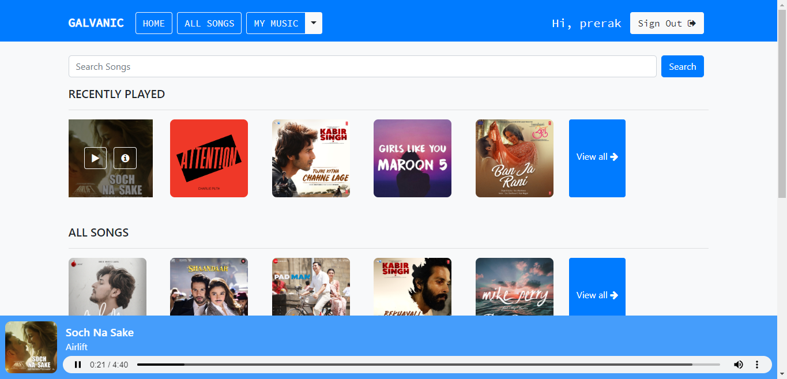
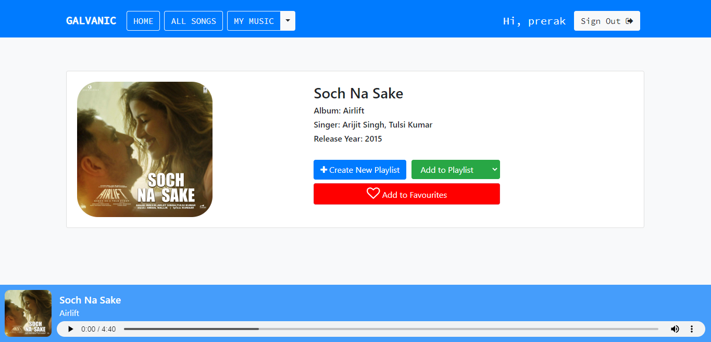

# MUSGEN

MUSGEN is a web-based music player built with Django. Beyond standard streaming features like playlists and listening history, the main idea behind the project was adding automatic genre classification: whenever you upload a song, it analyzes the audio file and predicts its genre using machine learning.



---

### What it does

- **Listen & browse**: Continuous audio player at the bottom of the screen while you browse songs, search by title, or filter by artist and language.
- **Auto-tag genres on upload**: Upload an audio file, and the app extracts 27 audio features (tempo, MFCCs, spectral centroid, rolloff, etc.) using `librosa`, scales them, and runs them through an SVM model to predict if it's rock, metal, hiphop, pop, blues, etc.
- **Personal library**: Save favourite tracks, organize your own playlists, and pick up from where you left off with a recently played list.
- **User accounts**: Simple signup and login system so each user has their own playlists, favourites, and history.



---

### How the genre classifier works

The machine learning piece lives in `musicapp/`:

1. **Feature extraction (`musicapp/Metadata.py`)**: When an audio track is uploaded, `librosa` computes:
   - Tempo & beat frames
   - Chroma STFT
   - Root Mean Square Energy (RMSE)
   - Spectral centroid, bandwidth, and rolloff
   - Zero crossing rate
   - 20 MFCCs (Mel-Frequency Cepstral Coefficients)
2. **Model prediction (`musicapp/predict.py`)**: The extracted 27 values are normalized with `MinMaxScaler` and fed into a Support Vector Classifier (`models.p`) trained on the GTZAN dataset (`data.csv`).
3. The predicted genre tag is then saved with the song in the database.

If you want to inspect or retrain the model, check out `preprocess.ipynb`.

---

### Getting it running locally

#### 1. Set up a virtual environment

```bash
# Windows
python -m venv .venv
.\.venv\Scripts\activate

# macOS / Linux
python3 -m venv .venv
source .venv/bin/activate
```

#### 2. Install dependencies

```bash
pip install -r requirements.txt
```

#### 3. Run database migrations

```bash
python manage.py migrate
```

*Note: The included `db.sqlite3` already has several sample songs loaded so you can test playback and search right away.*

#### 4. Start the development server

```bash
python manage.py runserver
```

Open [http://127.0.0.1:8000](http://127.0.0.1:8000) in your browser.

---

### Tests

To run the automated test suite:

```bash
python manage.py test
```

---

### Tech used

- Python & Django
- Scikit-learn, NumPy, Librosa
- Bootstrap 4, Font Awesome
- SQLite

---

### License

MIT
